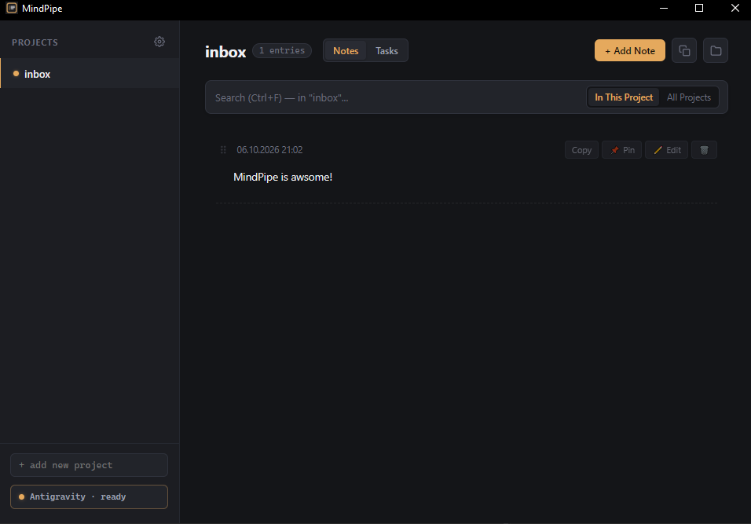
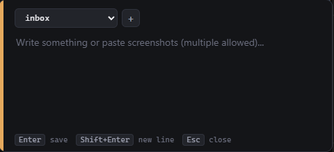
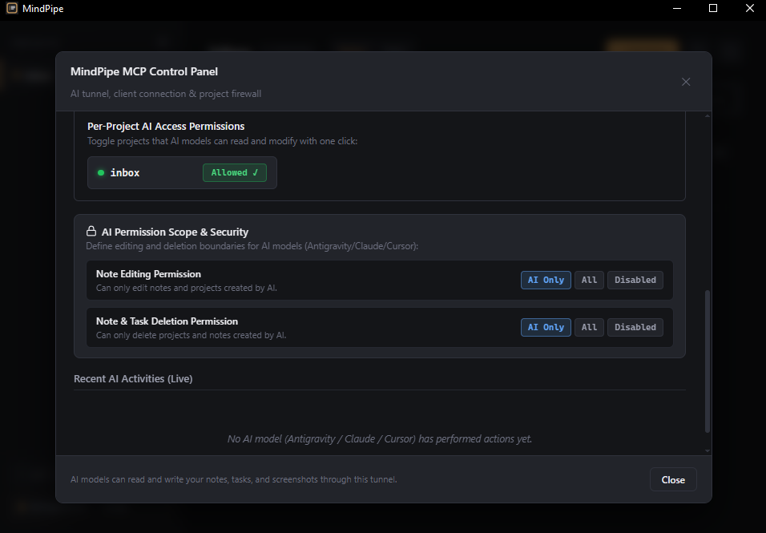
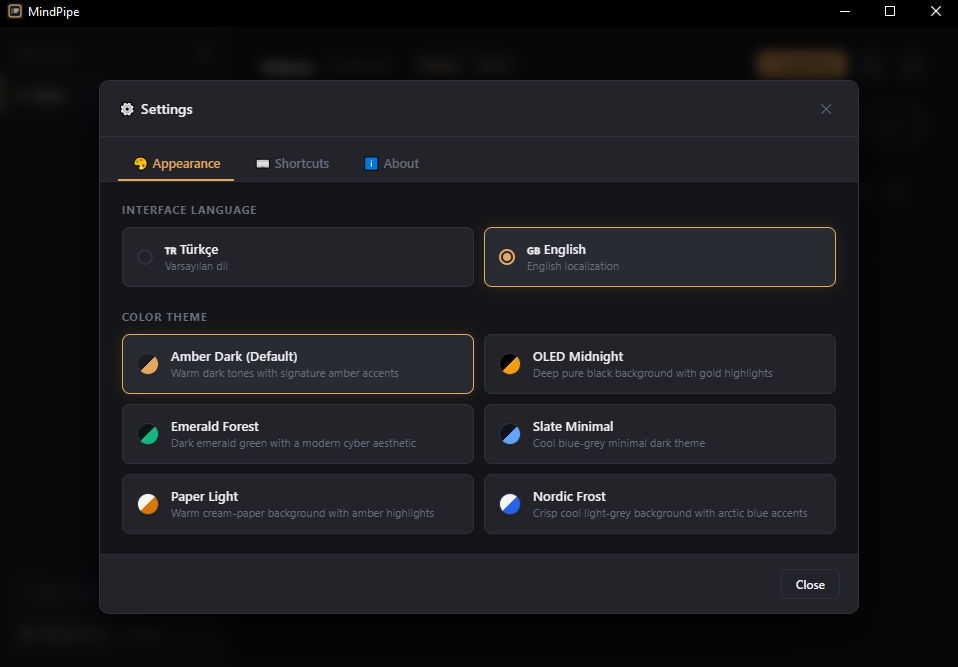
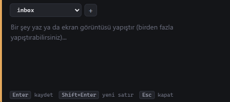
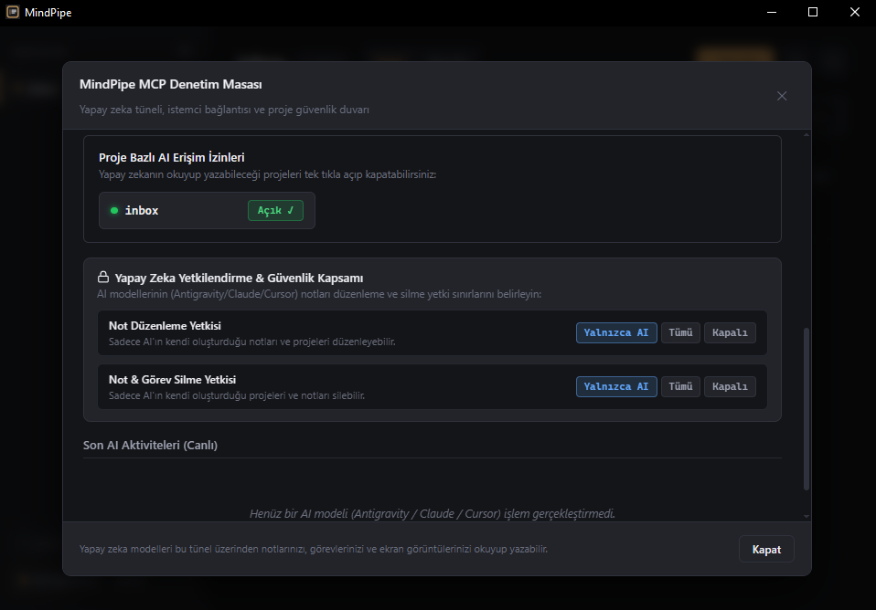
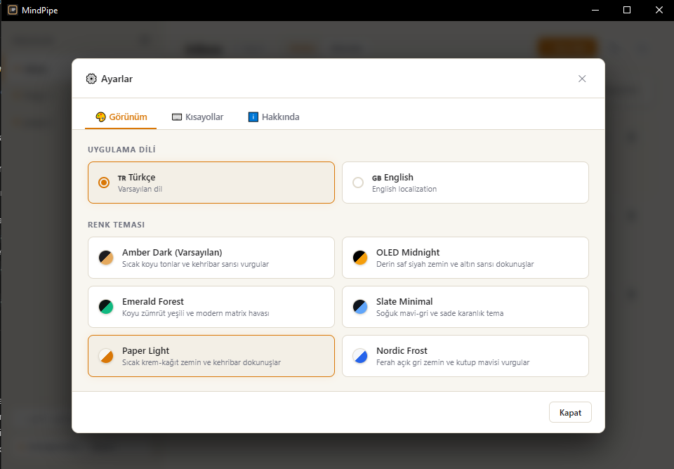
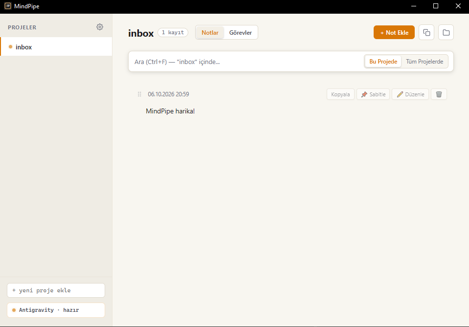

# MindPipe

[English](#english) | [Türkçe](#türkçe)

<p align="center">
  
</p>

---

<a name="english"></a>
## English

MindPipe is a lightweight, local-first desktop application and AI context bridge built with Tauri, Rust, and React. It serves as an instant capture tool, visual project dashboard, and real-time knowledge provider for AI agents via the Model Context Protocol (MCP).

All data is stored directly on your local file system as plain Markdown (`.md`) and standard PNG (`.png`) files. There is no cloud lock-in, no telemetry, and no proprietary database format.

### Download

| Platform | Recommended Package | Type |
| :--- | :--- | :--- |
| **Windows** | [Download `.exe` Setup](https://github.com/YusufB5/MindPipe/releases/latest) | Installer (x64) |
| **macOS** | [Download `.dmg`](https://github.com/YusufB5/MindPipe/releases/latest) | Apple Silicon & Intel |
| **Linux** | [Download `.AppImage`](https://github.com/YusufB5/MindPipe/releases/latest) | Portable (Universal) |

> 💡 All packages and alternative formats (`.msi`, `.deb`) are available on the **[Releases Page](https://github.com/YusufB5/MindPipe/releases/latest)**.

---

### Showcase

| Global Quick Capture (`Ctrl+Shift+N`) | Built-in MCP Control Panel & Firewall |
| :---: | :---: |
|  |  |

| Settings, Customizable Shortcuts & Themes | Continuous DevLog Stream & Tasks |
| :---: | :---: |
|  |  |

---

### Features

- **Global Quick Capture (`Ctrl+Shift+N`):**
  - Summon a minimalist capture bar from anywhere in the OS via a global hotkey.
  - Type quick thoughts or paste multiple screenshots directly from the clipboard (`Win+Shift+S` then `Ctrl+V`).
  - Shortcut is fully customizable (e.g. `Alt+Space`, `Ctrl+Alt+N`) and persists across reboots.
  - Drop image files straight onto the capture bar (Windows).
- **Drag & Drop Import:**
  - Drop images onto the dashboard to open the note composer with them attached, or drop `.txt` / `.md` files to turn each one into a note.
  - Safe by design: only real images and plain-text files are accepted (checked by content, not just extension), with size limits; anything else is skipped.
  - Platform support: dropping image files onto the capture bar is available on Windows; dragging selected text is available on macOS and Linux (on Windows, use cut and paste); dropping files onto the dashboard works on all platforms.
- **Run at Startup (optional):**
  - Settings → Startup: launch with the computer and start quietly in the tray, so the global shortcut and MCP connection are ready right after boot. Off by default.
  - A second launch focuses the running instance instead of opening another one. Available in installed builds.
- **Continuous DevLog Stream:**
  - Chronological activity feed with inline Markdown editing (`Ctrl+S`).
  - Pin important reference notes permanently to the top.
  - Collapsible cards for long logs (`Read more` / `Show less`).
  - Drag-and-drop manual card reordering, saved per project (`.order.json`).
  - Full-size image lightbox with multi-screenshot gallery reels.
  - Direct image pasting into the "+ Add Note" form on the dashboard.
- **Tags & Sub-notes:**
  - Colored per-note tags with a filter bar and a tag manager (stored in `.tags.json`).
  - One-level note hierarchy: drop a note on the middle of another card, use `+ Sub-note`, or `Detach` to move it back. Sub-notes start collapsed and open via the counter badge or the parent's `Read more`.
  - While filtering by tag, a matching sub-note stays visible under its (dimmed) parent.
- **Share Between Devices (`.mindpipe` bundles):**
  - Export a project to a single file and import it on another device; no cloud, no extra tools.
  - Projects carry a stable identity, so an import merges into the same project instead of duplicating or overwriting it.
  - Never loses work: if a note was edited on both sides, the other version is kept as a separate note tagged `sync-conflict`. Tags, pins and to-dos are merged as unions.
- **AI Trash:**
  - Notes deleted by AI agents are moved to the project's trash instead of being erased; restore them (tags and pin included) or delete them forever.
  - One-click "Empty trash" and an optional auto-clean policy (older than N days / more than N notes), off by default.
- **Safe Concurrent Editing:**
  - Metadata is written atomically and guarded by a per-project lock, so the app and AI agents can work on the same project without corrupting files.
  - Editing a note that changed in the meantime (for example by an AI agent) asks before overwriting; agents get a version check as well.
- **Project Organization & Tasks (TODOs):**
  - Clean workspaces for your codebases, ideas, and devlogs.
  - Project task management stored in human-readable plain text (`todos.md`).
  - Separate pending and completed lists with live task counter badges.
  - One-click native folder access in File Explorer.
- **Embedded Model Context Protocol (MCP) Server:**
  - Independent JSON-RPC 2.0 stdio server (`mcp-server.cjs`).
  - The binary automatically extracts `mcp-server.cjs` to your user AppData directory on launch.
  - Connects seamlessly to Claude Desktop, Cursor, Antigravity, Codex, and Windsurf.
  - Non-intrusive background file watcher providing real-time live synchronization between external AI modifications and the desktop UI.
  - Visual AI sparkle badge identifying projects, notes, and tasks created or managed by AI models.
  - Token-friendly progressive reading: agents can list notes one line each, read a single note, filter by tag or parent, and only pull full context when needed.
- **Granular Security Firewall & Permissions:**
  - Per-project access control: toggle AI read/write access per project with one click.
  - Permission scoping: configure AI edit and delete rights (`only_ai` created items, `all` items, or `none`).
  - Per-project overrides: pick a project from a dropdown to give it different edit/delete rights than the global setting.
  - Live activity pulse and audit log feed (in your language).
- **6 Color Themes & Custom Scrollbars:**
  - Dark Themes: Amber Dark (Default), OLED Midnight, Emerald Forest, Slate Minimal.
  - Light Themes: Paper Light (Warm Cream & Amber), Nordic Frost (Cool Grey & Sky Blue).
  - Modern sleek custom scrollbars matching the active theme palette.
- **Bilingual Localization:**
  - Switch between English and Turkish in real-time from the Settings menu; the quick capture window, tray menu and MCP activity log follow your choice.

---

### Architecture

- **Backend:** Rust (Tauri v2), handling global shortcuts, native file I/O, system tray lifecycle, and cross-platform window management.
- **Frontend:** React 18, TypeScript, Vite, with zero external UI framework dependencies.
- **MCP Server:** Embedded Node.js script communicating via standard input/output (`stdio`).
- **Storage Location:**
  - Windows: `%APPDATA%\com.mindpipe.app\projects\<project>\`
  - macOS: `~/Library/Application Support/com.mindpipe.app/projects/<project>/`
  - Linux: `~/.config/com.mindpipe.app/projects/<project>/`
- **Project folder contents:** notes (`<timestamp>.md`), screenshots (`.png`), `todos.md`, plus small plain-JSON metadata files: `.tags.json` (tags), `.tree.json` (sub-notes), `.pinned.json`, `.order.json`, `.project.json` (project identity), `.trash/` (AI-deleted notes). Everything stays human-readable.

---

### MCP Configuration

You can copy your pre-filled, personal configuration snippet directly by opening MindPipe and clicking the MCP Status bar on the bottom-left.

**Standard JSON (Claude Desktop, Cursor, Antigravity, Windsurf):**
- Claude Desktop: `%APPDATA%\Claude\claude_desktop_config.json`
- Cursor: `~/.cursor/mcp.json`
- Antigravity: `~/.gemini/config/mcp_config.json`

```json
{
  "mcpServers": {
    "mindpipe": {
      "command": "node",
      "args": [
        "C:\\Users\\<YOUR_USERNAME>\\AppData\\Roaming\\com.mindpipe.app\\mcp-server.cjs"
      ]
    }
  }
}
```

**Codex CLI (TOML):**
- Path: `~/.codex/config.toml`

```toml
[mcp_servers.mindpipe]
command = "node"
args = ['C:\Users\<YOUR_USERNAME>\AppData\Roaming\com.mindpipe.app\mcp-server.cjs']
```

#### Available MCP tools

| Tool | What it does |
| :--- | :--- |
| `notes_list_projects` | Lists the projects the agent may access |
| `notes_get_project_context` | Full context of a project (notes, pinned rules, to-dos); optional `tag` filter |
| `notes_list_notes` | Lightweight index, one line per note (title, summary, tags, size, date); `tag`, `parent`, `limit`, and `format: "json"` options |
| `notes_read_note` | Reads one note in full, including its version, tags and sub-notes |
| `notes_search` | Searches notes across projects; optional `tag` filter |
| `notes_add_note` | Adds a note, optionally with `tags` and a `parent` (sub-note) |
| `notes_edit_note` | Edits a note; pass `expected_version` to avoid overwriting newer changes |
| `notes_delete_note` | Moves a note to the project's trash (restorable) |
| `notes_set_tags` / `notes_set_parent` / `notes_pin_note` | Tag, nest or pin a note |
| `notes_add_todo` / `notes_toggle_todo` / `notes_delete_todo` | Manage project to-dos |
| `notes_get_image` / `notes_create_project` | Read a screenshot / create a project |

Every tool respects the per-project access setting from the MCP Control Panel; edit and delete tools also follow the edit/delete permissions (global or per-project override).

---

### Development & Build

#### Prerequisites
- Node.js 18+
- Rust (stable toolchain via `rustup`)
- [Tauri Prerequisites](https://v2.tauri.app/start/prerequisites/)

#### Development
```bash
# Install dependencies
npm install

# Run in development mode
npm run tauri dev
```

#### Production Build
```bash
# Compile optimized desktop binary and installers (EXE / MSI)
npm run tauri build
```
Compiled outputs will be located in `src-tauri/target/release/bundle/nsis/` and `src-tauri/target/release/bundle/msi/`.

---

<a name="türkçe"></a>
## Türkçe

MindPipe, Tauri, Rust ve React ile geliştirilmiş, hafif ve yerel öncelikli (local-first) masaüstü programı ve yapay zeka bağlam köprüsüdür. Hem hızlı bir not ve ekran görüntüsü yakalama aracı, hem kronolojik bir DevLog akışı, hem entegre bir görev yöneticisi, hem de Model Context Protocol (MCP) üzerinden yapay zeka ajanlarına doğrudan yapılandırılmış proje bilgisi aktaran bir terminaldir.

Tüm veriler doğrudan yerel dosya sisteminizde düz Markdown (`.md`) ve standart görsel (`.png`) dosyaları olarak tutulur. Bulut zorunluluğu, telemetri takibi ve kapalı veritabanı formatları bulunmaz.

### İndir

| Platform | Önerilen Paket | Tür |
| :--- | :--- | :--- |
| **Windows** | [`.exe` Kurulum Dosyasını İndir](https://github.com/YusufB5/MindPipe/releases/latest) | Kurulum Sihirbazı (x64) |
| **macOS** | [`.dmg` İndir](https://github.com/YusufB5/MindPipe/releases/latest) | Apple Silicon & Intel |
| **Linux** | [`.AppImage` İndir](https://github.com/YusufB5/MindPipe/releases/latest) | Taşınabilir (Universal) |

> 💡 Tüm bağımsız kurulum paketleri ve alternatif formatlar (`.msi`, `.deb`) **[Releases Sayfasında](https://github.com/YusufB5/MindPipe/releases/latest)** yer almaktadır.

---

### Ekran Görüntüleri

| Global Hızlı Yakalama (`Ctrl+Shift+N`) | Entegre MCP Denetim Masası & Güvenlik Duvarı |
| :---: | :---: |
|  |  |

| Ayarlar, Özelleştirilebilir Kısayollar & Temalar | DevLog Akışı & Görev Panosu |
| :---: | :---: |
|  |  |

---

### Özellikler

- **Global Hızlı Yakalama (`Ctrl+Shift+N`):**
  - İşletim sisteminin herhangi bir yerindeyken tek tuşla minimalist yakalama penceresini açın.
  - Hızlı notlar yazın veya panodaki ekran alıntılarını doğrudan yapıştırın (`Win+Shift+S` ardından `Ctrl+V`).
  - Global kısayol Ayarlar menüsünden tamamen özelleştirilebilir (`Alt+Space`, `Ctrl+Alt+N` vb.).
  - Görsel dosyalarını doğrudan yakalama çubuğuna bırakın (Windows).
- **Sürükle-Bırak ile İçe Aktarma:**
  - Görselleri panoya bırakınca not yazma kutusu görsellerle açılır; `.txt` / `.md` dosyalarını bırakınca her biri ayrı not olur.
  - Güvenli tasarım: yalnızca gerçek görseller ve düz metin dosyaları kabul edilir (uzantıya değil içeriğe bakılır), boyut sınırları vardır; diğer her şey atlanır.
  - Platform desteği: görsel dosyalarını yakalama çubuğuna bırakma Windows'ta, seçili metni sürükleyip bırakma macOS ve Linux'ta desteklenir (Windows'ta kes-yapıştır kullanılır); panoya dosya bırakma tüm platformlarda çalışır.
- **Açılışta Başlatma (isteğe bağlı):**
  - Ayarlar → Başlangıç: bilgisayarla birlikte başlatın ve tepsiye sessizce açın; böylece global kısayol ve MCP bağlantısı açılışta hazır olur. Varsayılan olarak kapalıdır.
  - İkinci kez açmaya çalışmak yeni kopya açmaz, çalışan pencereyi öne getirir. Kurulu sürümlerde kullanılabilir.
- **DevLog Sürekli Akışı:**
  - Kronolojik not akışı ve satır içi anlık Markdown düzenleme (`Ctrl+S`).
  - Önemli notları ve yönergeleri en üstte sabitleme (pin) desteği.
  - Uzun notlar için daraltma (`Devamını Gör` / `Daha az göster`).
  - Sürükle-bırak ile serbest kart sıralama (proje bazında `.order.json` dosyasında saklanır).
  - Çoklu ekran alıntıları için tam ekran görsel lightbox büyütücüsü.
  - Ana pano üzerindeki "+ Not Ekle" alanında doğrudan panodan görsel yapıştırma (`Ctrl+V`).
- **Etiketler ve Alt Notlar:**
  - Not başına renkli etiketler, filtre çubuğu ve etiket yöneticisi (`.tags.json` dosyasında saklanır).
  - Tek seviyeli not hiyerarşisi: bir notu başka bir kartın ortasına bırakın, `+ Alt not` kullanın ya da `Ayır` ile geri çıkarın. Alt notlar kapalı başlar, sayaç rozetiyle veya üst notun `Devamını Gör` butonuyla açılır.
  - Etikete göre filtrelerken eşleşen alt not, (soluk görünen) üst notunun altında görünmeye devam eder.
- **Cihazlar Arası Paylaşım (`.mindpipe` paketleri):**
  - Bir projeyi tek dosyaya aktarıp başka cihazda içe aktarın; bulut ve ek araç gerekmez.
  - Projeler kalıcı bir kimlik taşır; içe aktarma aynı projeyle birleşir, çoğaltmaz veya üzerine yazmaz.
  - Hiçbir şey kaybolmaz: bir not iki tarafta da düzenlendiyse diğer sürüm `sync-conflict` etiketli ayrı bir not olarak saklanır. Etiketler, sabitlemeler ve görevler birleşim olarak alınır.
- **AI Çöp Kutusu:**
  - AI ajanlarının sildiği notlar silinmez, projenin çöp kutusuna taşınır; etiket ve sabitleme dahil geri yüklenebilir ya da kalıcı silinebilir.
  - Tek tıkla "Çöp kutusunu boşalt" ve isteğe bağlı otomatik temizleme (N günden eski / N nottan fazla), varsayılan olarak kapalı.
- **Güvenli Eşzamanlı Düzenleme:**
  - Meta veriler atomik yazılır ve proje başına kilitle korunur; uygulama ve AI ajanları aynı projede dosyaları bozmadan çalışabilir.
  - Siz düzenlerken değişen bir notu (örneğin bir AI ajanı güncellediyse) kaydetmeden önce sorar; ajanlar için de sürüm kontrolü vardır.
- **Proje Organizasyonu ve Görevler (TODOs):**
  - Projelerinizi ayrı çalışma alanlarında izole edin.
  - Düz metin dosyasında tutulan görev listesi (`todos.md`).
  - Bekleyen ve tamamlanan görevler için ayrılmış sekmeler ve sayaçlar.
  - Tek tıkla yerel klasörü Dosya Gezgini'nde açma.
- **Gömülü Model Context Protocol (MCP) Sunucusu:**
  - Bağımsız JSON-RPC 2.0 stdio sunucusu (`mcp-server.cjs`).
  - Program ilk açılışta `mcp-server.cjs` dosyasını kullanıcının AppData klasörüne otomatik çıkartır.
  - Claude Desktop, Cursor, Antigravity, Codex ve Windsurf ile anında tam uyum.
  - Arka planda çalışan hafif dosya izleyici ile yapay zekanın yaptığı değişiklikler masaüstü panosuna canlı yansır.
  - AI ajanlarının ürettiği notlarda ve görevlerde görsel AI mikroçip rozeti ile şeffaf kaynak takibi.
  - Token dostu kademeli okuma: ajanlar notları satır satır listeleyebilir, tek bir notu okuyabilir, etikete veya üst nota göre filtreleyebilir ve tam bağlamı yalnızca gerektiğinde çekebilir.
- **Güvenlik Duvarı ve İzin Yönetimi:**
  - Proje bazlı erişim denetimi: AI modellerinin hangi projelere erişebileceğini tek tıkla açıp kapatın.
  - Yetki kapsamı: not düzenleme ve silme sınırlarını belirleyin (sadece AI'ın kendi ürettikleri, tümü veya salt okunur).
  - Proje bazlı istisnalar: açılır listeden bir proje seçip ona global ayardan farklı düzenleme/silme yetkisi verin.
  - Canlı işlem nabzı ve işlem geçmişi denetim günlüğü (seçtiğiniz dilde).
- **6 Renk Teması & Dinamik Kaydırma Çubukları:**
  - Karanlık Temalar: Amber Dark (Varsayılan), OLED Midnight, Emerald Forest, Slate Minimal.
  - Açık Temalar: Paper Light (Sıcak Kağıt & Amber), Nordic Frost (Ferah Gri & Kutup Mavisi).
  - Seçilen temaya göre otomatik renk alan modern ve ince kaydırma çubukları.
- **Çift Dil Desteği:**
  - Ayarlar menüsünden Türkçe ve İngilizce dilleri arasında anında geçiş yapın; hızlı yakalama penceresi, tepsi menüsü ve MCP işlem günlüğü de seçiminizi izler.

---

### Mimari ve Depolama

- **Arka uç:** Rust (Tauri v2): global kısayollar, yerel dosya I/O, sistem tepsisi ve pencere yönetimi.
- **Ön yüz:** React 18, TypeScript, Vite; harici UI çerçevesi yok.
- **MCP sunucusu:** Standart giriş/çıkış (`stdio`) üzerinden konuşan gömülü Node.js betiği.
- **Proje klasörü içeriği:** notlar (`<zaman damgası>.md`), ekran görüntüleri (`.png`), `todos.md` ve küçük düz-JSON meta dosyaları: `.tags.json` (etiketler), `.tree.json` (alt notlar), `.pinned.json`, `.order.json`, `.project.json` (proje kimliği), `.trash/` (AI'ın sildiği notlar). Her şey okunabilir kalır.
- **Konum:** Windows `%APPDATA%\com.mindpipe.app\projects\<proje>\`, macOS `~/Library/Application Support/com.mindpipe.app/projects/<proje>/`, Linux `~/.config/com.mindpipe.app/projects/<proje>/`.

---

### MCP Yapılandırması

MindPipe'ı açıp sol alttaki MCP Durum çubuğuna tıkladığınızda sisteminize özel hazır JSON kodunu tek tıkla kopyalayabilirsiniz.

**Standart JSON (Claude Desktop, Cursor, Antigravity, Windsurf):**
- Claude Desktop: `%APPDATA%\Claude\claude_desktop_config.json`
- Cursor: `~/.cursor/mcp.json`
- Antigravity: `~/.gemini/config/mcp_config.json`

```json
{
  "mcpServers": {
    "mindpipe": {
      "command": "node",
      "args": [
        "C:\\Users\\<KULLANICI_ADINIZ>\\AppData\\Roaming\\com.mindpipe.app\\mcp-server.cjs"
      ]
    }
  }
}
```

**Codex CLI (TOML):**
- Dosya: `~/.codex/config.toml`

```toml
[mcp_servers.mindpipe]
command = "node"
args = ['C:\Users\<KULLANICI_ADINIZ>\AppData\Roaming\com.mindpipe.app\mcp-server.cjs']
```

#### Kullanılabilir MCP araçları

| Araç | Ne yapar |
| :--- | :--- |
| `notes_list_projects` | Ajanın erişebildiği projeleri listeler |
| `notes_get_project_context` | Bir projenin tam bağlamı (notlar, sabit kurallar, görevler); isteğe bağlı `tag` filtresi |
| `notes_list_notes` | Hafif dizin, not başına tek satır (başlık, özet, etiket, boyut, tarih); `tag`, `parent`, `limit` ve `format: "json"` seçenekleri |
| `notes_read_note` | Tek bir notu sürümü, etiketleri ve alt notlarıyla tam okur |
| `notes_search` | Projeler arasında not arar; isteğe bağlı `tag` filtresi |
| `notes_add_note` | Not ekler; isteğe bağlı `tags` ve `parent` (alt not) |
| `notes_edit_note` | Notu düzenler; daha yeni değişikliklerin ezilmemesi için `expected_version` verilebilir |
| `notes_delete_note` | Notu projenin çöp kutusuna taşır (geri alınabilir) |
| `notes_set_tags` / `notes_set_parent` / `notes_pin_note` | Notu etiketler, iç içe geçirir veya sabitler |
| `notes_add_todo` / `notes_toggle_todo` / `notes_delete_todo` | Proje görevlerini yönetir |
| `notes_get_image` / `notes_create_project` | Ekran görüntüsü okur / proje oluşturur |

Tüm araçlar MCP Denetim Masası'ndaki proje erişimi ayarına uyar; düzenleme ve silme araçları ayrıca düzenleme/silme yetkilerini (global veya proje bazlı istisna) izler.

---

### Geliştirme ve Derleme

#### Gereksinimler
- Node.js 18+
- Rust (rustup ile güncel stable sürüm)
- [Tauri Başlangıç Kılavuzu](https://v2.tauri.app/start/prerequisites/)

#### Geliştirme Ortamı
```bash
# Bağımlılıkları yükleyin
npm install

# Geliştirme modunda çalıştırın
npm run tauri dev
```

#### Üretim Derlemesi (Build)
```bash
# Optimize edilmiş EXE ve kurulum paketlerini derleyin
npm run tauri build
```
Derleme çıktıları `src-tauri/target/release/bundle/nsis/` ve `src-tauri/target/release/bundle/msi/` klasörlerinde üretilir.

---

### Lisans
MIT License.
